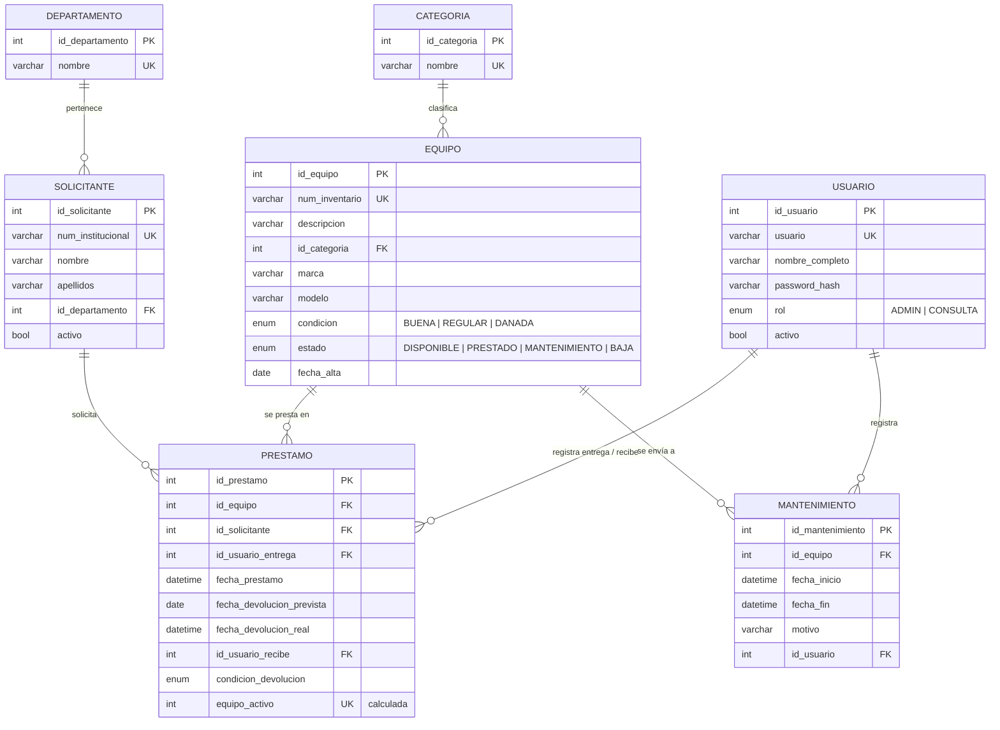

# Sistema de control de préstamos de equipo tecnológico

Proyecto integrador de **Taller de Base de Datos** (TecNM, Instituto Tecnológico de Colima, ago-dic 2026).

**Alumno:** Antonio Efraín Arellano Verduzco (23460504)
**Docente:** Sergio Viera González

## Propósito

Aplicación web para que el Departamento de Soporte y Servicios Tecnológicos registre sus equipos, a las personas que los solicitan, los préstamos y las devoluciones. Así siempre se sabe qué equipo está disponible, quién lo tiene y cuándo debe regresar, sin modificar la base de datos a mano.

## Tecnologías

Linux · Apache · PHP 8 · MariaDB · HTML, CSS y JavaScript

## Modelo de datos



| Tabla | Qué guarda |
|---|---|
| `departamento` | Áreas de la institución a las que pertenecen los solicitantes |
| `categoria` | Tipos de equipo: laptop, proyector, kit de electrónica, etc. |
| `usuario` | Personal que usa el sistema, con rol `ADMIN` (registra y modifica) o `CONSULTA` (solo consulta) |
| `solicitante` | Personas que piden equipo, identificadas por número institucional |
| `equipo` | Cada equipo físico con su número de inventario, condición y estado |
| `mantenimiento` | Cuándo y por qué un equipo salió de servicio y cuándo regresó |
| `prestamo` | Cada préstamo y, en la misma fila, su devolución |

### Cómo responde el modelo a las situaciones del documento

| Situación | Solución en la base de datos |
|---|---|
| 1. Préstamo duplicado | La columna calculada `equipo_activo` vale `id_equipo` mientras el préstamo no se devuelve. Su índice `UNIQUE` impide dos préstamos activos del mismo equipo, aunque se registren al mismo tiempo. |
| 2. Registro incompleto | El préstamo y el cambio de estado del equipo se harán en una **transacción** (avance del backend). El `CHECK ck_prestamo_devolucion_completa` impide devoluciones a medias. |
| 3. Equipo fuera de servicio | El estado `MANTENIMIENTO` y la tabla `mantenimiento`; el trigger y el procedimiento de préstamo (entrega final) rechazarán prestar equipos que no estén `DISPONIBLE`. |
| 4. Información histórica | Las llaves foráneas con `ON DELETE RESTRICT` impiden borrar equipos o personas con préstamos; se usa el estado `BAJA` o `activo = FALSE`. |
| 5. Acceso a la información | El rol de la aplicación en `usuario.rol` y, en la base de datos, usuarios y roles de MariaDB con privilegios distintos (script administrativo de la entrega final). |

## Instalación de la estructura

```bash
mariadb -u <usuario> -p < sql/01_estructura.sql
```

Crea la base `prestamos_equipo` con sus 7 tablas, llaves primarias y foráneas, restricciones `CHECK` e índices. Lo probé en MariaDB 12.3.

## Estructura del código

```
config/config.example.php   Plantilla de conexión (copiar como config.php; config.php no se sube)
app/db.php                  Conexión PDO a MariaDB y función consulta() para consultas parametrizadas
app/auth.php                Sesión, roles ADMIN / CONSULTA y protección CSRF
app/layout.php              Encabezado, menú, pie y utilidades (escape HTML, avisos)
public/                     Raíz web: páginas PHP, css/ y js/
sql/01_estructura.sql       DDL: tablas, llaves, CHECK e índices
sql/02_datos_prueba.sql     Datos iniciales de prueba
```

## Backend PHP + MariaDB

| Página | Operaciones SQL |
|---|---|
| `login.php` | `SELECT` del usuario con consulta parametrizada y `password_verify()` |
| `index.php` | `SELECT ... GROUP BY` (equipos por estado) y `JOIN` de 4 tablas (préstamos por vencer) |
| `equipos.php` | **`INSERT`**, **`UPDATE`**, **`DELETE`** y `SELECT` con `JOIN` a categoría. El cambio a mantenimiento se hace en una transacción que abre o cierra su registro en `mantenimiento`. |
| `solicitantes.php` | `INSERT`, `UPDATE`, `DELETE`, activar o desactivar, y `SELECT` con `JOIN` y subconsulta de préstamos activos |
| `prestamos.php` | **Transacción:** `SELECT ... FOR UPDATE` del equipo, `INSERT` del préstamo y `UPDATE` del equipo a `PRESTADO`; si algo falla, `ROLLBACK` |
| `devoluciones.php` | **Transacción:** `UPDATE` del préstamo con fecha real, quién recibe y condición, y `UPDATE` del equipo (`DISPONIBLE`, o `MANTENIMIENTO` si regresó dañado) |
| `consultas.php` | Las 5 consultas del documento con `JOIN`: listado general, disponibles, préstamos activos, vencidos (con `DATEDIFF`) e historial por persona o equipo |

**Seguridad:**
- Todas las consultas que reciben datos del usuario usan **consultas preparadas** (`PDO::prepare` + `execute`).
- La salida se escapa con `htmlspecialchars`.
- Los formularios llevan un token **CSRF**.
- Las contraseñas se guardan con `password_hash`.
- El rol `CONSULTA` no puede modificar nada; el servidor responde 403.

**Reglas del negocio comprobadas en pruebas:**
- Un equipo prestado no se presta otra vez.
- Un equipo en mantenimiento no se presta.
- No se aceptan fechas de devolución pasadas.
- Un equipo o solicitante con historial no se borra: se da de baja o se desactiva.
- Un número de inventario repetido se rechaza.

## Instalación en un servidor (Apache + PHP 8 + MariaDB)

```bash
mariadb -u <usuario> -p < sql/01_estructura.sql
mariadb -u <usuario> -p prestamos_equipo < sql/02_datos_prueba.sql
cp config/config.example.php config/config.php   # y editar host, base, usuario y contraseña
```

Publica la carpeta del proyecto en Apache, con `public/` como raíz del sitio, y abre `login.php`. Los usuarios de prueba están documentados al inicio de `sql/02_datos_prueba.sql`.

Para probar en local sin Apache: `php -S 127.0.0.1:8770 -t public`.

## Frontend

- `public/css/estilos.css`: diseño **responsivo** sin frameworks para escritorio, tableta y celular, con menú hamburguesa en pantallas chicas.
- `public/js/app.js`: menú móvil, filtros de tablas, pestañas y validación de formularios antes de enviarlos a PHP. PHP y MariaDB vuelven a validar.

## Avances

| Fecha | Entrega | Estado |
|---|---|---|
| 13 nov | Registro del repositorio | ✅ |
| 16 nov | Estructura de la base de datos (DDL) | ✅ `sql/01_estructura.sql` |
| 20 nov | Frontend | ✅ `public/` |
| 27 nov | Backend PHP y operaciones con MariaDB | ✅ `app/`, `public/*.php`, `sql/02_datos_prueba.sql` |
| 4 dic | Aplicación completa, script SQL y manual | ⬜ |
