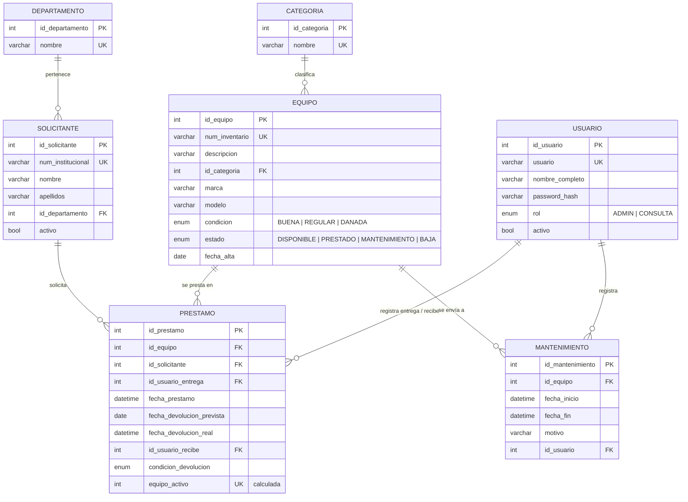

# Sistema de control de préstamos de equipo tecnológico

Proyecto integrador de **Taller de Base de Datos** (TecNM, Instituto Tecnológico de Colima, ago-dic 2026).

**Alumno:** Antonio Efraín Arellano Verduzco (23460504)
**Docente:** Sergio Viera González

## Propósito

Aplicación web para que el Departamento de Soporte y Servicios Tecnológicos registre sus equipos, a las personas que los solicitan, los préstamos y las devoluciones. Así siempre se sabe qué equipo está disponible, quién lo tiene y cuándo debe regresar, sin modificar la base de datos a mano.

## Tecnologías

Linux · Apache · PHP 8 · MariaDB · HTML, CSS y JavaScript

## Modelo de datos



| Tabla | Qué guarda |
|---|---|
| `departamento` | Áreas de la institución a las que pertenecen los solicitantes |
| `categoria` | Tipos de equipo: laptop, proyector, kit de electrónica, etc. |
| `usuario` | Personal que usa el sistema, con rol `ADMIN` (registra y modifica) o `CONSULTA` (solo consulta) |
| `solicitante` | Personas que piden equipo, identificadas por número institucional |
| `equipo` | Cada equipo físico con su número de inventario, condición y estado |
| `mantenimiento` | Cuándo y por qué un equipo salió de servicio y cuándo regresó |
| `prestamo` | Cada préstamo y, en la misma fila, su devolución |

### Cómo responde el modelo a las situaciones del documento

| Situación | Solución en la base de datos |
|---|---|
| 1. Préstamo duplicado | La columna calculada `equipo_activo` vale `id_equipo` mientras el préstamo no se devuelve. Su índice `UNIQUE` impide dos préstamos activos del mismo equipo, aunque se registren al mismo tiempo. |
| 2. Registro incompleto | El préstamo y el cambio de estado del equipo se harán en una **transacción** (avance del backend). El `CHECK ck_prestamo_devolucion_completa` impide devoluciones a medias. |
| 3. Equipo fuera de servicio | El estado `MANTENIMIENTO` y la tabla `mantenimiento`; el trigger y el procedimiento de préstamo (entrega final) rechazarán prestar equipos que no estén `DISPONIBLE`. |
| 4. Información histórica | Las llaves foráneas con `ON DELETE RESTRICT` impiden borrar equipos o personas con préstamos; se usa el estado `BAJA` o `activo = FALSE`. |
| 5. Acceso a la información | El rol de la aplicación en `usuario.rol` y, en la base de datos, usuarios y roles de MariaDB con privilegios distintos (script administrativo de la entrega final). |

## Instalación de la estructura

```bash
mariadb -u <usuario> -p < sql/01_estructura.sql
```

Crea la base `prestamos_equipo` con sus 7 tablas, llaves primarias y foráneas, restricciones `CHECK` e índices. Lo probé en MariaDB 12.3.

## Frontend (`public/`)

| Página | Función | Operación que hará con MariaDB |
|---|---|---|
| `login.html` | Inicio de sesión del encargado | Verificar usuario y rol (`ADMIN` / `CONSULTA`) |
| `index.html` | Panel con indicadores y accesos rápidos | Conteos por estado y préstamos vencidos |
| `equipos.html` | Alta y edición de equipos, filtro por estado | `INSERT` / `UPDATE` / `SELECT` con `JOIN` a categoría |
| `solicitantes.html` | Alta de solicitantes y listado | `INSERT` / `SELECT` con `JOIN` a departamento |
| `prestamos.html` | Registrar préstamo (solo equipos disponibles) y ver activos | Transacción: `INSERT` en préstamo + `UPDATE` del equipo |
| `devoluciones.html` | Registrar devolución con su condición | `UPDATE` del préstamo y del estado del equipo |
| `consultas.html` | Las 5 consultas: general, disponibles, activos, vencidos e historial | `SELECT` con `JOIN` y filtros |

- `css/estilos.css`: diseño **responsivo** sin frameworks (escritorio, tableta y celular; menú hamburguesa en pantallas chicas).
- `js/app.js`: menú móvil, filtros de tablas, pestañas y validación de formularios (campos obligatorios, formatos y fecha de devolución no anterior a hoy).
- Los datos de las tablas son **de ejemplo**; en el avance del backend se reemplazan por consultas PHP + MariaDB.

Para verlo en local: `python -m http.server 8765 --directory public` y abrir http://localhost:8765.

## Avances

| Fecha | Entrega | Estado |
|---|---|---|
| 13 nov | Registro del repositorio | ✅ |
| 16 nov | Estructura de la base de datos (DDL) | ✅ `sql/01_estructura.sql` |
| 20 nov | Frontend | ✅ `public/` |
| 27 nov | Backend PHP y operaciones con MariaDB | ⬜ |
| 4 dic | Aplicación completa, script SQL y manual | ⬜ |
